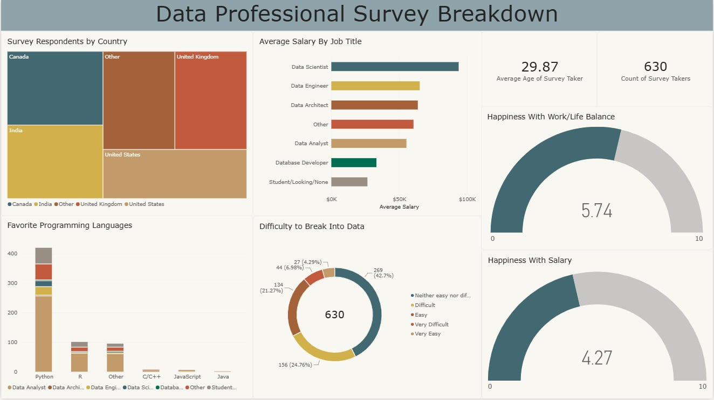

# Data Professionals Survey Analysis | Power BI

## Overview

An interactive Power BI dashboard exploring career trends among data professionals, including salaries, programming language preferences, geographic distribution, job satisfaction, and the difficulty of entering the data industry.

## Tools & Technologies

- Microsoft Power BI Desktop
- Power Query
- Data Cleaning & Transformation
- Data Visualization

## Data Preparation

Performed data cleaning and transformation in Power Query, including:

- Splitting columns by delimiters
- Changing data types
- Removing unnecessary columns
- Duplicating and transforming columns
- Filtering rows
- Replacing and standardizing values
- Creating custom columns

## Dashboard Features

- Survey respondent count and average age
- Average salary comparison by job title
- Programming language preferences
- Geographic distribution of respondents
- Work/life balance and salary satisfaction
- Difficulty of breaking into the data industry

## Methodology

Survey responses were cleaned and transformed using Power Query before visualization.

Salary comparisons use average values grouped by job title. Salary figures are stored in thousands of US dollars; for example, 53 represents $53,000.

The findings describe survey respondents and should not be interpreted as representative of the entire data industry.

## How to View

Download `dashboard.pbix` and open it using Microsoft Power BI Desktop.

## Dataset & Credits

Dataset source: [Alex The Analyst — Power BI GitHub Repository](https://github.com/AlexTheAnalyst/Power-BI)

This project was developed while following Alex The Analyst's Power BI tutorial, with additional dashboard formatting and refinements.

## Author

Ahmed Soltani
